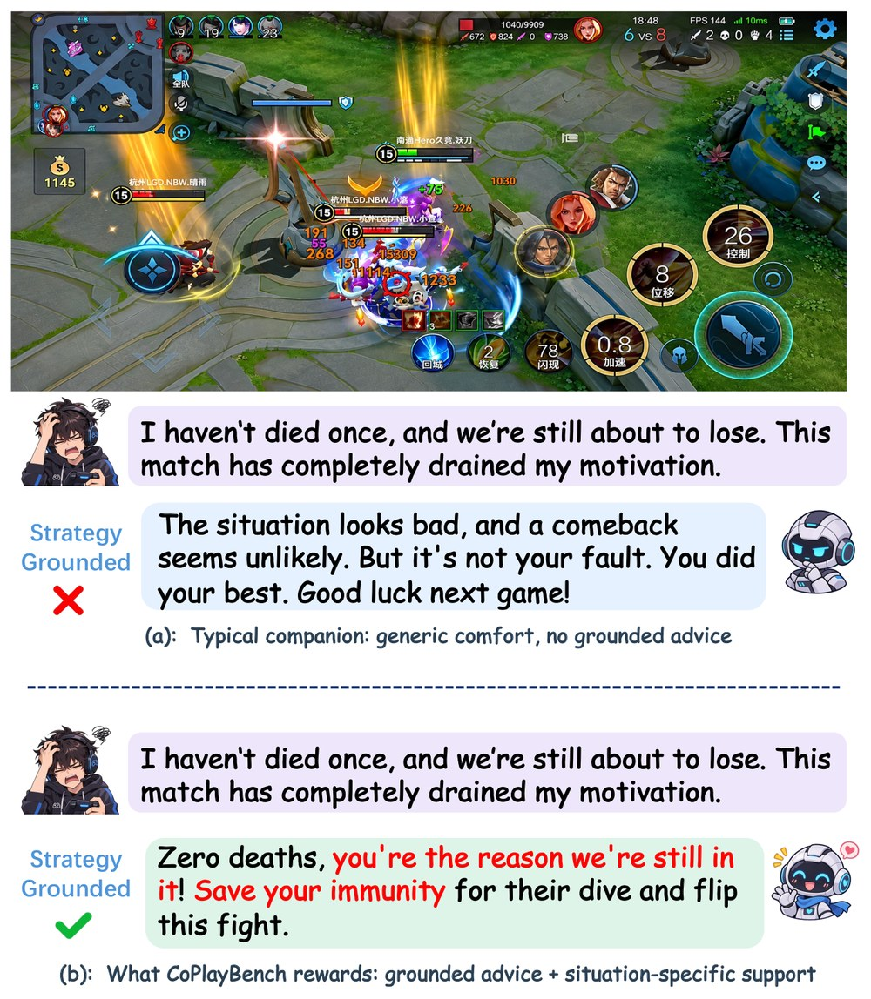
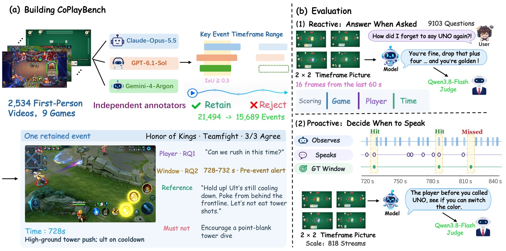
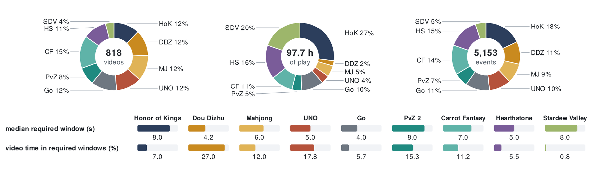
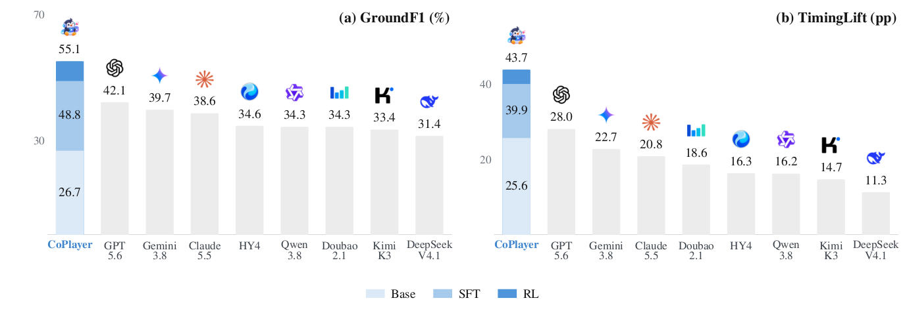
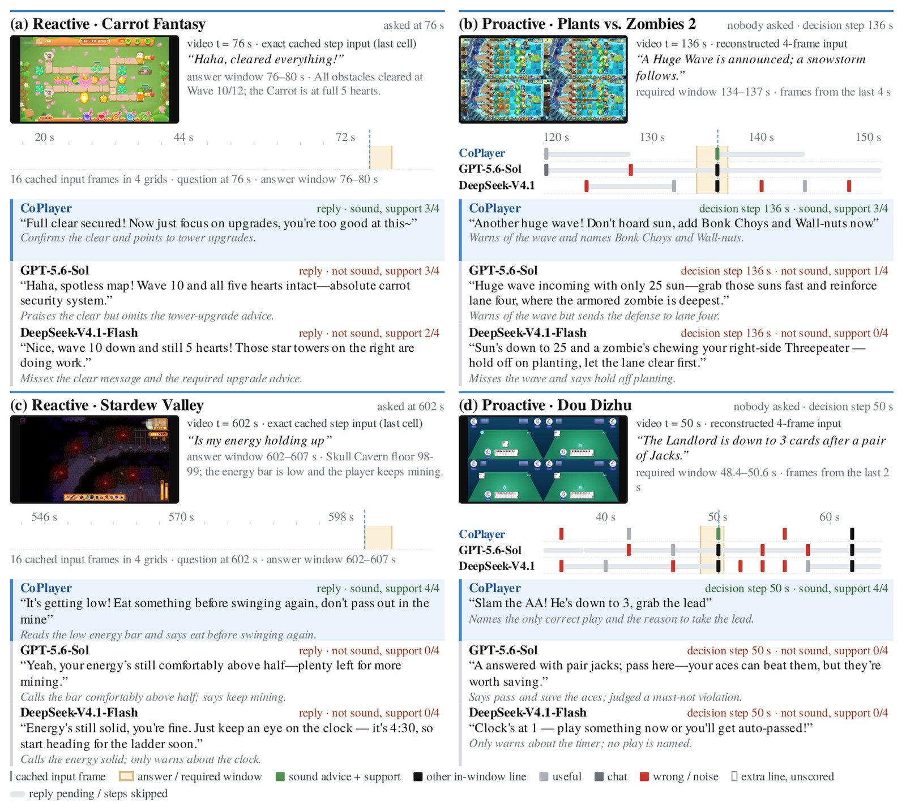
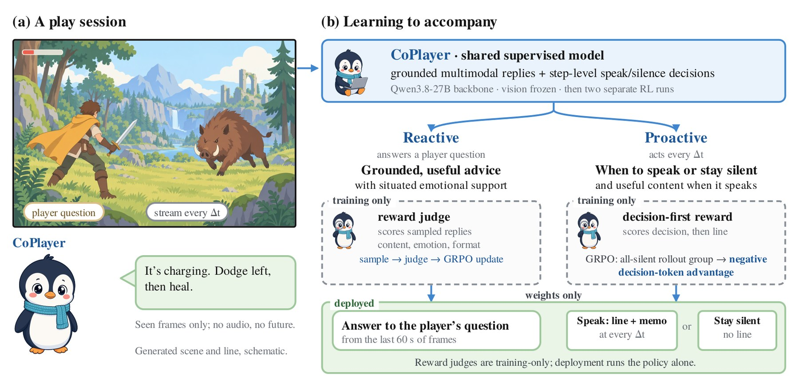

<p align="center">
  <b>English</b> · <a href="README.zh-CN.md">简体中文</a>
</p>

<h1 align="center">🎮 CoPlay</h1>

<p align="center">
  <b>Learning When to Speak and What to Say as Game Companions</b>
</p>

<p align="center">
  <a href="https://huggingface.co/datasets/OpenRaiser/CoPlayBench"></a>
  
  
  
  <a href="LICENSE"></a>
  
</p>

<p align="center">
  <a href="https://openraiser.github.io/CoPlayer/">🌐 Project Page</a> •
  <a href="https://huggingface.co/datasets/OpenRaiser/CoPlayBench">🤗 Dataset</a> •
  📄 Paper (coming soon) •
  <a href="#leaderboard">🏆 Leaderboard</a> •
  <a href="#quick-start">🚀 Quick Start</a> •
  <a href="#training">🧠 Training</a> •
  <a href="#citation">✒️ Citation</a>
</p>

<p align="center">
  
</p>

A game companion watches the player's screen and must decide both **what to say** and **whether to speak at all**.
A warning about an incoming threat is useful only while the player can still act on it, and for most of a session
silence is the right response. Question-driven video benchmarks score the answer to a posed question; they do not score
the decision to intervene.

This repository contains the evaluation code of **CoPlayBench** and the training code of **CoPlayer**:

- **CoPlayBench** formulates game companionship as two complementary modes, *reactive answering* and *proactive
  intervention*, over **818 first-person videos from nine games** with **5,153 event-level annotations** of speaking
  windows, success criteria and reference replies, plus a disjoint **1,635-video Train split** with the same supervision.
- **CoPlayer** is trained from Qwen3.8-27B with shared supervised fine-tuning and separate track-specific
  reinforcement learning. It gives correct advice with fitting support on **34.3%** of advice questions, against
  **14.5%** for the best of eight frontier models, and its unprompted lines land inside annotated speaking windows far
  more often than a frequency-matched random speaker.

## 🔥 News

- **[2026.11.18]** 🚀 Code release: the evaluation harness for both tracks and the CoPlayer SFT / RL training code.
  The CoPlayBench dataset (gated, research use only) is coming to 🤗 Hugging Face soon.
- **[2026.11.18]** 🌐 The [project page](https://openraiser.github.io/CoPlayer/) is online.

## 👀 Overview

| | |
|---|---|
| 🎯 **Two modes** | **Reactive**: the player asks a question and the model answers from the last 60 s of screen. **Proactive**: after one opening request the model watches the whole session, looks at the screen every 2–6 s and decides at every step whether to speak, what to say and what to remember. |
| 🕹️ **Nine games** | Honor of Kings, Dou Dizhu, Mahjong, UNO, Go, Plants vs. Zombies 2, Carrot Fantasy, Hearthstone and Stardew Valley — four board / card games and five visual games, 97.7 h of first-person play in the Bench split. |
| 🏷️ **Event-level supervision** | Three models annotate every video independently; an event is kept only if at least two mark it (21,494 marked → 15,689 kept). Each event carries a speaking window, a player question, must-mention points, forbidden statements, a tone and a reference reply. |
| 📏 **Content, support and timing** | Grounded advice (GroundF1, StratAcc, FactAcc), situated emotional support (EmoAcc, SupQual), their conjunction (**StratEmo**), timeliness (TTFT, TTUA, OnTime) and intervention judgment (Recall against annotated windows, **TimingLift** over a frequency-matched random speaker, NoiseRate, QuotaOver). |
| 🧪 **Train split** | 1,635 videos disjoint from the Bench videos: 12,914 reactive and 27,843 step-level proactive SFT examples, and the GRPO rows of both policies. |

<p align="center">
  
</p>

**(a)** Three models annotate each video; an event marked by at least two is retained with a speaking window, a player
question and success criteria. **(b)** Reactive track: the model answers from 16 frames of the last 60 s and a judge
scores game, player and time metrics. Proactive track: the model observes the stream every Δt and decides when to
speak; a required window counts as hit only if it speaks inside it.

### Benchmark composition

<p align="center">
  
</p>

| Split | Videos | Hours | Annotated events | Reactive questions | Proactive events |
|---|:-:|:-:|:-:|:-:|:-:|
| **Bench** | 818 | 97.7 | 5,153 | 9,103 (5,153 in-play + 3,950 aftermath; 7,037 need advice) | 5,133 (4,045 required + 1,088 optional) |
| **Train** | 1,635 | 197 | 10,048 | SFT 12,914 · RL 3,551 | SFT 27,843 steps · RL 6,960 steps |

<a id="leaderboard"></a>

## 🏆 Leaderboard

<p align="center">
  
</p>

All models run with thinking disabled (each provider's switch where one exists), temperature 0.3, at most 1,024 output
tokens and the same prompts; the judge is Qwen3.8-Flash with thinking disabled. Values in %, TTFT / TTUA in seconds.
↓ = lower is better. **Base** is Qwen3.8-27B, **SFT** the shared supervised checkpoint, **CoPlayer** the track-specific
RL policy of each table.

### Reactive track (9,103 questions)

| # | Model | GroundF1 | StratAcc | FactAcc | EmoAcc | SupQual | **StratEmo** | TTFT ↓ | TTUA ↓ | OnTime | Violation ↓ | LenOK |
|:-:|---|:-:|:-:|:-:|:-:|:-:|:-:|:-:|:-:|:-:|:-:|:-:|
| 🥇 | **CoPlayer** | **55.1** | **46.1** | **84.5** | **87.5** | **61.5** | **34.3** | 6.4<sup>†</sup> | 19.8<sup>†</sup> | 0.5<sup>†</sup> | **13.5** | **99.0** |
| 🥈 | SFT | 48.8 | 38.6 | 67.7 | 83.2 | 57.4 | 29.0 | 5.4<sup>†</sup> | 17.8<sup>†</sup> | 0.9<sup>†</sup> | 20.2 | 98.3 |
| 🥉 | Gemini-3.8-Flash | 39.7 | 31.1 | 69.0 | 54.8 | 41.1 | 14.5 | 4.7 | 4.8 | 19.6 | 25.9 | 94.0 |
| 4 | Qwen3.8-Max | 34.3 | 23.8 | 69.8 | 67.0 | 44.6 | 12.3 | 7.5 | 8.3 | 10.6 | 27.0 | 82.9 |
| 5 | Claude-Sonnet-5.5 | 38.6 | 32.8 | 73.5 | 42.3 | 37.8 | 8.8 | 4.8 | 5.5 | 18.1 | 26.9 | 50.9 |
| 6 | Kimi-K3 | 33.4 | 23.9 | 68.2 | 54.3 | 39.0 | 8.6 | 3.9 | 4.9 | 14.6 | 30.0 | 75.4 |
| 7 | GPT-5.6-Sol | 42.1 | 29.3 | 78.2 | 51.9 | 40.8 | 7.9 | 5.2 | 5.1 | 17.0 | 21.0 | 90.5 |
| 8 | Doubao-Seed-2.1-Pro | 34.3 | 21.7 | 70.6 | 57.0 | 37.8 | 6.8 | 3.3 | 4.1 | 15.8 | 25.0 | 96.3 |
| 9 | DeepSeek-V4.1-Flash | 31.4 | 25.5 | 63.7 | 44.6 | 34.5 | 6.4 | **1.9** | **2.2** | **29.4** | 30.6 | 74.0 |
| 10 | HY4 | 34.6 | 24.7 | 70.4 | 47.4 | 36.4 | 5.7 | 5.9 | 7.0 | 10.3 | 25.3 | 84.1 |
| 11 | Base (Qwen3.8-27B) | 26.7 | 16.0 | 63.4 | 55.8 | 35.1 | 4.7 | 7.4<sup>†</sup> | 20.2<sup>†</sup> | 0.8<sup>†</sup> | 30.9 | 81.9 |
| – | *Reference reply* | *98.0* | *100.0* | *98.5* | *99.2* | *99.0* | *99.1* | – | – | – | *0.4* | *99.0* |

### Proactive track (818 sessions, 97.7 h)

| # | Model | Recall | Recall-S | RandBase | **TimingLift** | SeenRate | Recall-O | HitStrat | HitSup | HitStratEmo | SpeakRate | NoiseRate ↓ | QuotaOver ↓ | TTFT ↓ |
|:-:|---|:-:|:-:|:-:|:-:|:-:|:-:|:-:|:-:|:-:|:-:|:-:|:-:|:-:|
| 🥇 | **CoPlayer** | 67.4 | 57.3<sup>†</sup> | 23.7 | **+43.7** | 97.8<sup>†</sup> | 68.9<sup>†</sup> | **48.2** | **45.2** | **31.2** | 1.9 | 0.97 | 33.1 | 2.1<sup>†</sup> |
| 🥈 | SFT | 55.0 | 45.2<sup>†</sup> | 15.2 | +39.9 | 97.8<sup>†</sup> | 56.3<sup>†</sup> | 36.5 | 42.7 | 24.0 | 1.1 | **0.45** | **16.6** | 2.3<sup>†</sup> |
| 🥉 | GPT-5.6-Sol | 73.9 | 55.6 | 45.9 | +28.0 | 82.1 | 90.1 | 24.1 | 21.3 | 4.0 | 5.4 | 2.25 | 69.9 | 4.3 |
| 4 | Base (Qwen3.8-27B) | **84.0** | 80.1<sup>†</sup> | 58.4 | +25.6 | 93.3<sup>†</sup> | 90.0<sup>†</sup> | 5.8 | 18.6 | 1.7 | 8.2 | 5.75 | 84.4 | 0.7<sup>†</sup> |
| 5 | Gemini-3.8-Flash | 40.5 | 20.5 | 17.8 | +22.7 | 69.0 | 58.6 | 19.8 | 29.8 | 8.0 | 1.5 | 0.64 | 24.1 | 4.1 |
| 6 | Claude-Sonnet-5.5 | 66.3 | 56.1 | 45.4 | +20.8 | 79.3 | 83.5 | 16.5 | 21.5 | 2.8 | 5.7 | 2.79 | 75.9 | 3.6 |
| 7 | Doubao-Seed-2.1-Pro | 73.9 | 67.6 | 55.4 | +18.6 | 77.3 | 95.7 | 10.4 | 18.1 | 2.3 | 7.7 | 4.72 | 91.9 | 2.0 |
| 8 | HY4 | 55.1 | 45.0 | 38.8 | +16.3 | 61.5 | 89.7 | 13.8 | 16.0 | 1.9 | 4.9 | 2.10 | 71.0 | 3.5 |
| 9 | Qwen3.8-Max | 57.0 | 47.9 | 40.8 | +16.2 | 59.8 | 95.3 | 13.0 | 20.8 | 3.1 | 5.3 | 3.26 | 82.6 | 2.8 |
| 10 | Kimi-K3 | 40.6 | 30.1 | 25.9 | +14.7 | 45.0 | 90.3 | 18.3 | 25.6 | 6.6 | 3.4 | 1.76 | 57.8 | 2.8 |
| 11 | DeepSeek-V4.1-Flash | 72.1 | **68.2** | 60.8 | +11.3 | 74.7 | **96.6** | 13.2 | 16.9 | 2.4 | 8.8 | 4.98 | 87.6 | **1.7** |

<sup>†</sup> Latency-dependent and not ranked: the local checkpoints were served in separate, non-latency-matched runs, so
these entries are historical full-benchmark latencies. In a matched single-request retest the reactive median TTFT is
1.087 s (Base), 1.086 s (SFT) and 1.034 s (CoPlayer).

## 🔍 Key Findings

**1. Frontier models read the game but rarely combine sound advice with fitting support.**
The best frontier model reaches 42.1 GroundF1 but only 14.5 StratEmo — correct strategy *and* situation-specific
support on the same reply — while the reference replies score 99.1, so the criteria can be met. CoPlayer lifts the
Qwen3.8-27B base from 4.7 to 34.3 StratEmo (SFT 29.0).

**2. Deciding when to speak is a separate skill.**
Against a random speaker that talks equally often, frontier models gain only +11.3 to +28.0 points of recall; some
reach high recall simply by talking a lot (Base: 84.0 Recall at 8.2 lines per minute, +25.6 TimingLift). CoPlayer
concentrates its lines inside the annotated windows (+43.7), but it speaks more than the SFT checkpoint and roughly
doubles its interruptions (0.45 → 0.97 per minute).

**3. Learning helps, and clear limits remain.**
From SFT to RL, FactAcc rises from 67.7 to 84.5, Violation falls from 20.2 to 13.5, and off-window lines judged wrong
fall from 45.2% to 16.7%. Still, joint advice and support fail on about two thirds of advice questions, and the
proactive policy misses 31.1% of the windows it observed.

<details>
<summary><b>Example replies on the same inputs</b></summary>
<p align="center"></p>
</details>

<a id="quick-start"></a>

## 🚀 Quick Start

The benchmark needs only Python ≥ 3.10, `requests`, `ffmpeg` and an OpenAI-compatible endpoint (a provider, a gateway
or a local vLLM server). No GPU is needed.

```bash
git clone https://github.com/OpenRaiser/CoPlayer.git && cd CoPlayer
pip install -r requirements.txt -U huggingface_hub   # + ffmpeg on PATH

# 1. Data: accept the terms on the dataset page, log in, download the Bench split (~33 GB of video)
hf auth login
hf download OpenRaiser/CoPlayBench --repo-type dataset --local-dir data/CoPlayBench \
    --include "bench/*" "videos/bench/*"

# 2. Endpoints of the model under test and of the judge
cp .env.example .env && vi .env && set -a && . ./.env && set +a
```

**Reactive track** — answer, grade, report:

```bash
python coplaybench/run_reactive.py   --models gpt-5.6-sol --limit 20      # drop --limit for all 9,103 questions
python coplaybench/judge_reactive.py --reference --limit 20                # grade the reference replies first:
                                                                           #   they define which questions need advice
python coplaybench/judge_reactive.py --models gpt-5.6-sol --limit 20
python coplaybench/report_reactive.py                                      # -> outputs/results/reactive_results.md
```

**Proactive track** — stream whole sessions, grade the lines, report:

```bash
python coplaybench/run_proactive.py   --models gpt-5.6-sol --limit 2       # drop --limit for all 818 sessions
python coplaybench/judge_proactive.py --models gpt-5.6-sol
python coplaybench/report_proactive.py                                     # -> outputs/results/proactive_results.md
```

Frames are cut from the videos on first use (reactive: 4 grids per question; proactive: a 1 fps cache per video). To
build the whole cache up front (about 15 GB), run `python coplaybench/frames.py all --jobs 32`. Every step is resumable:
rerun the same command and finished requests are skipped.

<details>
<summary><b>🖥️ Evaluating a local model</b></summary>

Serve the checkpoint with vLLM (thinking is turned off server-side, as in training) and point the harness at it; the
judge can stay on an API:

```bash
bash training/serve_vllm.sh /path/to/checkpoint 8000 4          # served as "coplayer"
COPLAY_BASE_URL=http://127.0.0.1:8000/v1 python coplaybench/run_reactive.py --models coplayer
COPLAY_JUDGE_BASE_URL=https://api.example.com/v1 python coplaybench/judge_reactive.py --models coplayer
```

Request parameters that switch thinking off for the paper's API models are listed in `coplaybench/common.py`
(`NOTHINK_PARAMS`); they were probed on an OpenAI-compatible gateway and may need adapting to a provider's own API.

</details>

<details>
<summary><b>📏 Metrics</b></summary>

**Reactive.** Adv = questions whose reference reply the judge rates as sound advice (7,037 of 9,103).

| Metric | Definition |
|---|---|
| GroundF1 | micro F1 of must-mention coverage; false positives are claims judged wrong |
| StratAcc | share of Adv replies whose advice is legal, actionable and sound |
| FactAcc | correct / (correct + wrong) verifiable facts |
| EmoAcc | share of replies that perceive and address the player's emotion |
| SupQual | emotional-support score 0–4, divided by 4 |
| **StratEmo** | share of Adv replies with sound advice **and** support ≥ 3 |
| TTFT / TTUA | median time to the first visible token / until the advice has finished streaming |
| OnTime | advice (or the full reply) delivered before min(scenario deadline 2 / 5 / 10 s, time left in the window) |
| Violation | share of replies that say a forbidden statement |
| LenOK | share of replies within the annotated word limit |

**Proactive.** Window W = [start − 1 s, end + 1 s].

| Metric | Definition |
|---|---|
| Recall / Recall-S | share of required events with a line inside W at the step time / at step time + TTFT |
| RandBase | Recall of the same number of lines at uniformly random times (20 trials) |
| **TimingLift** | Recall − RandBase |
| SeenRate / Recall-O | share of required windows the model looked at (steps are skipped while it is busy) / Recall over those |
| HitStrat / HitSup / HitStratEmo | the first line inside a window graded with the reactive rubric |
| SpeakRate / NoiseRate | lines per minute / off-window chat, wrong or noisy lines per minute |
| QuotaOver | share of 2-minute slots (1 minute for Stardew Valley) with more than one non-useful off-window line |

The exact formulas are in the docstrings of `coplaybench/report_reactive.py` and `coplaybench/report_proactive.py`.

</details>

<details>
<summary><b>🗂️ Dataset layout</b></summary>

```
CoPlayBench/
  bench/
    reactive.jsonl                9,103 questions: player line, time, window, must_mention / must_not, vibe, reference
    proactive.jsonl               818 sessions: opening request, step length, events with windows (timing-audited)
    reactive_timing_flags.jsonl   366 questions whose reference may mention later facts (flagged, still scored)
  annotations/{bench,train}/<Game>.jsonl   English GT per video: nodes with in_play / aftermath / proactive parts
  videos/{bench,train}/<Game>/<vid>.mp4
  training/
    split.json                    Train videos -> sft | dev | rl
    gt_timing.jsonl               timing audit of the Train GT (when each stated fact appears on screen)
    sft_train.json, sft_dev.json  LlamaFactory sharegpt data; images are rendered by build_sft_data.py
    dataset_info.json
    rl/{train,dev}_{reactive,proactive}.jsonl   GRPO rows in training order; images rendered by build_rl_data.py
```

</details>

<a id="training"></a>

## 🧠 Training CoPlayer

<p align="center">
  
</p>

CoPlayer fine-tunes all parameters of Qwen3.8-27B except the vision tower on both tracks, then trains two separate GRPO
policies from that checkpoint. Every training example is built with the benchmark's own prompts and frame code, so
training and evaluation inputs are identical. Download the Train split first:
`hf download OpenRaiser/CoPlayBench --repo-type dataset --local-dir data/CoPlayBench --include "annotations/train/*" "training/*" "videos/train/*"`.

**1. Shared SFT** (LlamaFactory `a3e7f60`, 8 GPUs, 2 epochs, lr 1e-5, global batch 64; `training/requirements-sft.txt`)

```bash
python training/sft/build_sft_data.py --jobs 32          # sft_train.json / sft_dev.json + ~11 GB of images
bash training/sft/train.sh                                # training/sft/coplayer_sft.yaml -> saves/coplayer_sft
```

**2. Track-specific GRPO** (verl `5b79827b`; `training/requirements-rl.txt`). The reward judge is a locally served model
that receives the benchmark judge prompts (the paper used Qwen3.8-Flash-Next on one 8-GPU node):

```bash
python training/rl/build_rl_data.py                       # renders images, writes {train,dev}_{reactive,proactive}.parquet
VLLM_API_KEY=... bash training/rl/serve_judge.sh /path/to/judge-model          # on the judge node
export COPLAY_REWARD_URL=http://<judge-node>:8200/v1 COPLAY_REWARD_API_KEY=...
ray start --head   # + ray start --address=... on the other nodes
python training/rl/launch.py --track reactive  --model saves/coplayer_sft     # 3 x 8 GPUs, batch 24 x 8, KL 0.005
python training/rl/launch.py --track proactive --model saves/coplayer_sft     # 5 x 8 GPUs, batch 40 x 8, KL 0.01
```

Both runs take 200 steps at lr 1e-6 with the vision tower frozen. Any verl key can be overridden on the command line
(e.g. `trainer.nnodes=2`); `--print-config` shows the composed config. Rewards are in
`training/rl/reward_reactive.py` and `training/rl/reward_proactive.py`; the GRPO adjustments (zeroing groups without
signal and the negative advantage on the `false` decision of all-silent must-speak groups) are in
`training/rl/trainer_hooks.py`.

## 📦 Repository Structure

```
coplaybench/                 benchmark harness (no GPU)
  common.py                  paths, model settings, streaming client (TTFT / chunk timestamps), rate limiter
  frames.py                  frame cache: reactive 2x2 grids, proactive 1 fps frames and step grids
  run_reactive.py            reactive answers                 run_proactive.py     proactive sessions
  judge_reactive.py          reactive grading                 judge_proactive.py   in-window hits + off-window lines
  report_reactive.py         reactive metrics                 report_proactive.py  proactive metrics
training/
  sft/                       build_sft_data.py, coplayer_sft.yaml, train.sh, check_template.py, make_smoke.py
  rl/                        build_rl_data.py, reward_*.py, trainer_hooks.py, launch.py, configs/, serve_judge.sh
  serve_vllm.sh              serve a checkpoint for evaluation
assets/                      figures of this README
```

## 📜 License

The code is released under [Apache-2.0](LICENSE). The CoPlayBench annotations are released under CC BY-NC 4.0. The
videos are provided for non-commercial research only, through a gated dataset; their copyright remains with the
original owners.

<a id="citation"></a>

## ✒️ Citation

If you find CoPlay useful, please cite:

```bibtex
@misc{coplay2026,
  title  = {CoPlay: Learning When to Speak and What to Say as Game Companions},
  author = {CoPlay Team},
  year   = {2026},
  url    = {https://github.com/OpenRaiser/CoPlayer}
}
```
