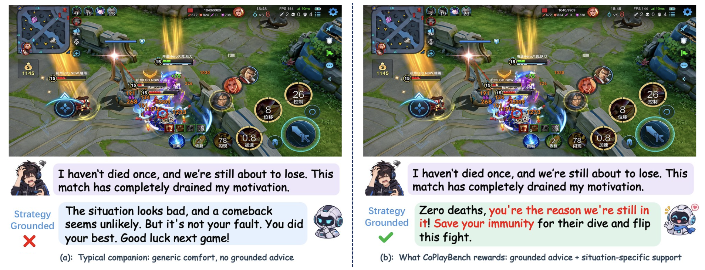
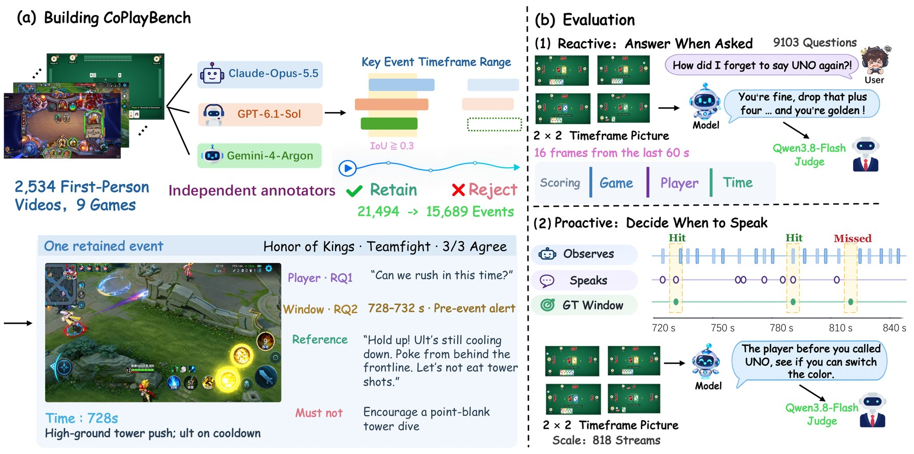
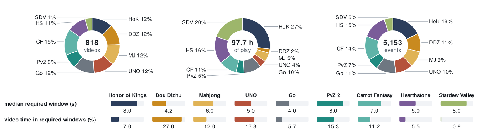
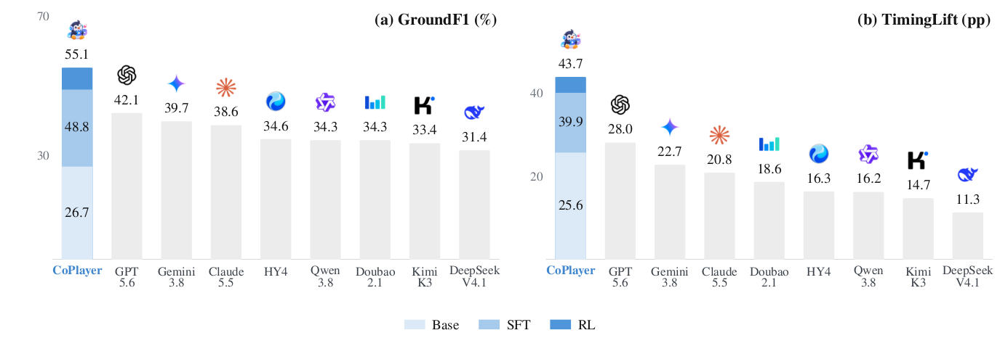
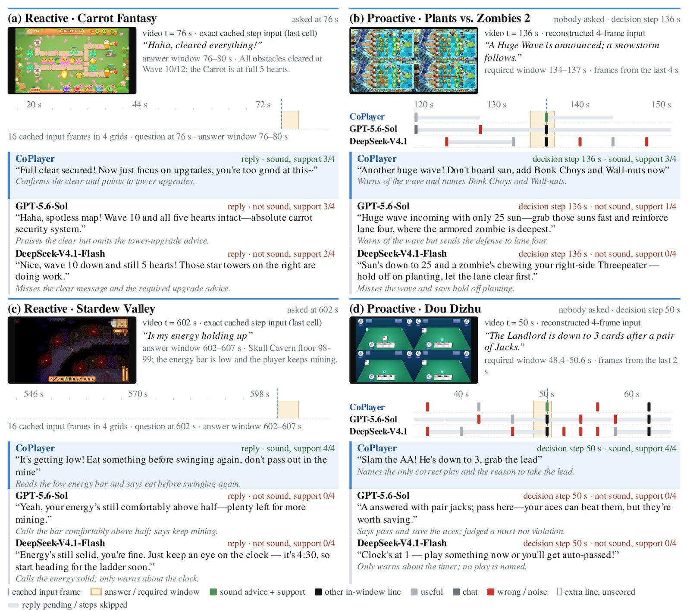
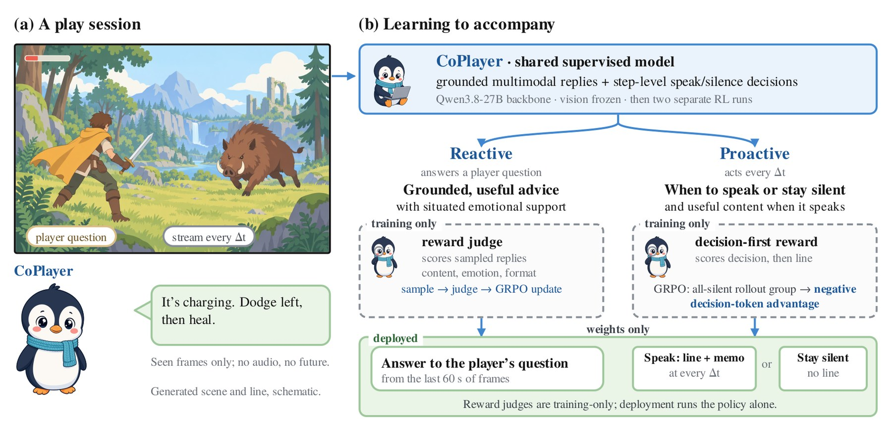

<p align="center">
  <a href="README.md">English</a> · <b>简体中文</b>
</p>

<h1 align="center">🎮 CoPlay</h1>

<p align="center">
  <b>Learning When to Speak and What to Say as Game Companions</b><br>
  让游戏陪伴模型学会何时开口、说什么
</p>

<p align="center">
  <a href="https://huggingface.co/datasets/OpenRaiser/CoPlayBench"></a>
  
  
  
  <a href="LICENSE"></a>
  
</p>

<p align="center">
  <a href="https://openraiser.github.io/CoPlayer/">🌐 项目主页</a> •
  <a href="https://huggingface.co/datasets/OpenRaiser/CoPlayBench">🤗 数据集</a> •
  📄 论文（即将公开） •
  <a href="#leaderboard">🏆 排行榜</a> •
  <a href="#quick-start">🚀 快速开始</a> •
  <a href="#training">🧠 训练</a> •
  <a href="#citation">✒️ 引用</a>
</p>

<p align="center">
  
</p>

游戏陪伴模型和玩家看着同一块屏幕，既要决定**说什么**，也要决定**要不要开口**。危险预警只有在玩家还来得及反应时才有用，
而一局游戏的大部分时间里，保持安静才是对的。现有的视频问答基准只给"回答一个已经提出的问题"打分，不评估"要不要主动介入"这个决定。

本仓库包含 **CoPlayBench** 的评测代码和 **CoPlayer** 的训练代码：

- **CoPlayBench** 把游戏陪伴拆成两种互补的模式：**被动应答**（reactive）和**主动介入**（proactive）。评测集包含
  **9 款游戏的 818 个第一视角视频**、**5,153 个事件级标注**（开口时间窗、成功标准、参考回复），另有与之不重叠的
  **1,635 个视频的 Train 划分**，标注方式相同。
- **CoPlayer** 基于 Qwen3.8-27B，先做两个任务共享的监督微调，再分别做两条任务各自的强化学习。在需要给建议的问题上，
  它有 **34.3%** 的回复同时给出了正确建议和贴合情境的情绪支持，8 个前沿模型中最好的只有 **14.5%**；它主动说的话落在
  标注开口窗口内的比例，也远高于说话频率相同的随机基线。

## 🔥 动态

- **[2026.11.18]** 🚀 发布代码：两个任务的评测框架，以及 CoPlayer 的 SFT / RL 训练代码。CoPlayBench 数据集（需申请，
  仅限研究用途）即将上传到 🤗 Hugging Face。
- **[2026.11.18]** 🌐 [项目主页](https://openraiser.github.io/CoPlayer/)上线。

## 👀 概览

| | |
|---|---|
| 🎯 **两种模式** | **被动应答**：玩家提问，模型根据最近 60 秒的画面回答。**主动介入**：玩家只在开头说一句话，模型看完整局，每 2–6 秒看一次画面，每一步自己决定要不要说、说什么、记下什么。 |
| 🕹️ **9 款游戏** | 王者荣耀、斗地主、麻将、UNO、围棋、植物大战僵尸 2、保卫萝卜、炉石传说、星露谷物语——4 款棋牌、5 款视觉类游戏，Bench 划分共 97.7 小时第一视角录像。 |
| 🏷️ **事件级标注** | 三个模型各自独立标注每个视频，至少两个模型都标出的事件才保留（21,494 → 15,689）。每个事件有开口时间窗、玩家提问、必须提到的要点、禁止说的内容、语气和参考回复。 |
| 📏 **内容、支持、时机** | 有依据的建议（GroundF1、StratAcc、FactAcc）、贴合情境的情绪支持（EmoAcc、SupQual）、两者同时满足（**StratEmo**）、及时性（TTFT、TTUA、OnTime），以及主动介入的判断（窗口召回、相对等频随机发言者的 **TimingLift**、NoiseRate、QuotaOver）。 |
| 🧪 **Train 划分** | 1,635 个视频，与 Bench 视频不重叠：12,914 条被动应答和 27,843 条逐步主动决策的 SFT 样本，以及两条 RL 策略的 GRPO 数据。 |

<p align="center">
  
</p>

**(a)** 三个模型分别标注每个视频，至少两个模型标出的事件才保留，并配上开口时间窗、玩家提问和成功标准。
**(b)** 被动应答：模型根据最近 60 秒内的 16 帧作答，由评审模型给游戏、玩家、时间三类指标打分。主动介入：模型每隔 Δt
看一次画面，自己决定何时开口；只有在必须开口的窗口内说了话才算命中。

### 数据构成

<p align="center">
  
</p>

| 划分 | 视频 | 时长（小时） | 标注事件 | 被动应答题 | 主动介入事件 |
|---|:-:|:-:|:-:|:-:|:-:|
| **Bench** | 818 | 97.7 | 5,153 | 9,103（局中 5,153 + 赛后 3,950；其中 7,037 题需要建议） | 5,133（必须 4,045 + 可选 1,088） |
| **Train** | 1,635 | 197 | 10,048 | SFT 12,914 · RL 3,551 | SFT 27,843 步 · RL 6,960 步 |

<a id="leaderboard"></a>

## 🏆 排行榜

<p align="center">
  
</p>

所有模型都关闭思考（有开关的厂商都用其开关）、温度 0.3、最多输出 1,024 token、使用同一套 Prompt；评审模型为关闭思考的
Qwen3.8-Flash。数值单位为 %，TTFT / TTUA 单位为秒，↓ 表示越低越好。**Base** 是 Qwen3.8-27B，**SFT** 是共享监督微调模型，
**CoPlayer** 是对应任务的 RL 策略。

### 被动应答（9,103 题）

| # | 模型 | GroundF1 | StratAcc | FactAcc | EmoAcc | SupQual | **StratEmo** | TTFT ↓ | TTUA ↓ | OnTime | Violation ↓ | LenOK |
|:-:|---|:-:|:-:|:-:|:-:|:-:|:-:|:-:|:-:|:-:|:-:|:-:|
| 🥇 | **CoPlayer** | **55.1** | **46.1** | **84.5** | **87.5** | **61.5** | **34.3** | 6.4<sup>†</sup> | 19.8<sup>†</sup> | 0.5<sup>†</sup> | **13.5** | **99.0** |
| 🥈 | SFT | 48.8 | 38.6 | 67.7 | 83.2 | 57.4 | 29.0 | 5.4<sup>†</sup> | 17.8<sup>†</sup> | 0.9<sup>†</sup> | 20.2 | 98.3 |
| 🥉 | Gemini-3.8-Flash | 39.7 | 31.1 | 69.0 | 54.8 | 41.1 | 14.5 | 4.7 | 4.8 | 19.6 | 25.9 | 94.0 |
| 4 | Qwen3.8-Max | 34.3 | 23.8 | 69.8 | 67.0 | 44.6 | 12.3 | 7.5 | 8.3 | 10.6 | 27.0 | 82.9 |
| 5 | Claude-Sonnet-5.5 | 38.6 | 32.8 | 73.5 | 42.3 | 37.8 | 8.8 | 4.8 | 5.5 | 18.1 | 26.9 | 50.9 |
| 6 | Kimi-K3 | 33.4 | 23.9 | 68.2 | 54.3 | 39.0 | 8.6 | 3.9 | 4.9 | 14.6 | 30.0 | 75.4 |
| 7 | GPT-5.6-Sol | 42.1 | 29.3 | 78.2 | 51.9 | 40.8 | 7.9 | 5.2 | 5.1 | 17.0 | 21.0 | 90.5 |
| 8 | Doubao-Seed-2.1-Pro | 34.3 | 21.7 | 70.6 | 57.0 | 37.8 | 6.8 | 3.3 | 4.1 | 15.8 | 25.0 | 96.3 |
| 9 | DeepSeek-V4.1-Flash | 31.4 | 25.5 | 63.7 | 44.6 | 34.5 | 6.4 | **1.9** | **2.2** | **29.4** | 30.6 | 74.0 |
| 10 | HY4 | 34.6 | 24.7 | 70.4 | 47.4 | 36.4 | 5.7 | 5.9 | 7.0 | 10.3 | 25.3 | 84.1 |
| 11 | Base (Qwen3.8-27B) | 26.7 | 16.0 | 63.4 | 55.8 | 35.1 | 4.7 | 7.4<sup>†</sup> | 20.2<sup>†</sup> | 0.8<sup>†</sup> | 30.9 | 81.9 |
| – | *参考回复* | *98.0* | *100.0* | *98.5* | *99.2* | *99.0* | *99.1* | – | – | – | *0.4* | *99.0* |

### 主动介入（818 局，97.7 小时）

| # | 模型 | Recall | Recall-S | RandBase | **TimingLift** | SeenRate | Recall-O | HitStrat | HitSup | HitStratEmo | SpeakRate | NoiseRate ↓ | QuotaOver ↓ | TTFT ↓ |
|:-:|---|:-:|:-:|:-:|:-:|:-:|:-:|:-:|:-:|:-:|:-:|:-:|:-:|:-:|
| 🥇 | **CoPlayer** | 67.4 | 57.3<sup>†</sup> | 23.7 | **+43.7** | 97.8<sup>†</sup> | 68.9<sup>†</sup> | **48.2** | **45.2** | **31.2** | 1.9 | 0.97 | 33.1 | 2.1<sup>†</sup> |
| 🥈 | SFT | 55.0 | 45.2<sup>†</sup> | 15.2 | +39.9 | 97.8<sup>†</sup> | 56.3<sup>†</sup> | 36.5 | 42.7 | 24.0 | 1.1 | **0.45** | **16.6** | 2.3<sup>†</sup> |
| 🥉 | GPT-5.6-Sol | 73.9 | 55.6 | 45.9 | +28.0 | 82.1 | 90.1 | 24.1 | 21.3 | 4.0 | 5.4 | 2.25 | 69.9 | 4.3 |
| 4 | Base (Qwen3.8-27B) | **84.0** | 80.1<sup>†</sup> | 58.4 | +25.6 | 93.3<sup>†</sup> | 90.0<sup>†</sup> | 5.8 | 18.6 | 1.7 | 8.2 | 5.75 | 84.4 | 0.7<sup>†</sup> |
| 5 | Gemini-3.8-Flash | 40.5 | 20.5 | 17.8 | +22.7 | 69.0 | 58.6 | 19.8 | 29.8 | 8.0 | 1.5 | 0.64 | 24.1 | 4.1 |
| 6 | Claude-Sonnet-5.5 | 66.3 | 56.1 | 45.4 | +20.8 | 79.3 | 83.5 | 16.5 | 21.5 | 2.8 | 5.7 | 2.79 | 75.9 | 3.6 |
| 7 | Doubao-Seed-2.1-Pro | 73.9 | 67.6 | 55.4 | +18.6 | 77.3 | 95.7 | 10.4 | 18.1 | 2.3 | 7.7 | 4.72 | 91.9 | 2.0 |
| 8 | HY4 | 55.1 | 45.0 | 38.8 | +16.3 | 61.5 | 89.7 | 13.8 | 16.0 | 1.9 | 4.9 | 2.10 | 71.0 | 3.5 |
| 9 | Qwen3.8-Max | 57.0 | 47.9 | 40.8 | +16.2 | 59.8 | 95.3 | 13.0 | 20.8 | 3.1 | 5.3 | 3.26 | 82.6 | 2.8 |
| 10 | Kimi-K3 | 40.6 | 30.1 | 25.9 | +14.7 | 45.0 | 90.3 | 18.3 | 25.6 | 6.6 | 3.4 | 1.76 | 57.8 | 2.8 |
| 11 | DeepSeek-V4.1-Flash | 72.1 | **68.2** | 60.8 | +11.3 | 74.7 | **96.6** | 13.2 | 16.9 | 2.4 | 8.8 | 4.98 | 87.6 | **1.7** |

<sup>†</sup> 与延迟相关，不参与排名：本地模型是在各自独立、未对齐延迟条件的部署下跑的，这些数值是当时全量评测的历史延迟。
在对齐条件的单请求复测中，被动应答的 TTFT 中位数为 Base 1.087 秒、SFT 1.086 秒、CoPlayer 1.034 秒。

## 🔍 主要发现

**1. 前沿模型看得懂局面，但很少能把正确建议和贴切的支持结合起来。**
最好的前沿模型 GroundF1 有 42.1，但 StratEmo（同一条回复里既给出正确策略、又给出贴合情境的支持）只有 14.5；参考回复能拿到
99.1，说明这个标准是可以达到的。CoPlayer 把 Qwen3.8-27B 基座的 StratEmo 从 4.7 提升到 34.3（SFT 为 29.0）。

**2. 决定何时开口是一项独立的能力。**
和说话频率相同的随机发言者相比，前沿模型的召回只高出 +11.3 到 +28.0 个点；有的模型靠多说话拿到高召回（Base：召回 84.0，
每分钟 8.2 句，TimingLift +25.6）。CoPlayer 把话集中在标注的开口窗口内（+43.7），但说得比 SFT 多，打扰也翻了一倍左右
（每分钟 0.45 → 0.97 句）。

**3. 学习有效，但局限仍很明显。**
从 SFT 到 RL，FactAcc 从 67.7 升到 84.5，Violation 从 20.2 降到 13.5，窗口外被判为错误的发言从 45.2% 降到 16.7%。
但在需要建议的问题上，仍有约三分之二没能同时做到正确建议和贴切支持；主动策略也错过了 31.1% 它看到过的窗口。

<details>
<summary><b>相同输入下的回复示例</b></summary>
<p align="center"></p>
</details>

<a id="quick-start"></a>

## 🚀 快速开始

评测只需要 Python ≥ 3.10、`requests`、`ffmpeg` 和一个 OpenAI 兼容接口（厂商 API、网关或本地 vLLM 服务都可以），不需要 GPU。

```bash
git clone https://github.com/OpenRaiser/CoPlayer.git && cd CoPlayer
pip install -r requirements.txt -U huggingface_hub   # 另需 ffmpeg 在 PATH 中

# 1. 数据：先在数据集页面同意使用条款，登录后下载 Bench 划分（视频约 33 GB）
hf auth login
hf download OpenRaiser/CoPlayBench --repo-type dataset --local-dir data/CoPlayBench \
    --include "bench/*" "videos/bench/*"

# 2. 配置被测模型和评审模型的接口
cp .env.example .env && vi .env && set -a && . ./.env && set +a
```

**被动应答**——作答、评审、出报告：

```bash
python coplaybench/run_reactive.py   --models gpt-5.6-sol --limit 20      # 去掉 --limit 即跑全部 9,103 题
python coplaybench/judge_reactive.py --reference --limit 20                # 先评参考回复：它决定哪些题需要建议
python coplaybench/judge_reactive.py --models gpt-5.6-sol --limit 20
python coplaybench/report_reactive.py                                      # -> outputs/results/reactive_results.md
```

**主动介入**——跑完整会话、评审发言、出报告：

```bash
python coplaybench/run_proactive.py   --models gpt-5.6-sol --limit 2       # 去掉 --limit 即跑全部 818 局
python coplaybench/judge_proactive.py --models gpt-5.6-sol
python coplaybench/report_proactive.py                                     # -> outputs/results/proactive_results.md
```

帧会在第一次用到时从视频里截取（被动应答每题 4 张拼图，主动介入每个视频一份 1 fps 帧缓存）。想提前建好全部缓存（约 15 GB）
可以运行 `python coplaybench/frames.py all --jobs 32`。每一步都支持断点续跑：重新执行同一条命令会跳过已完成的请求。

<details>
<summary><b>🖥️ 评测本地模型</b></summary>

用 vLLM 部署模型（在服务端关闭思考，与训练一致），再把评测框架指向它；评审模型可以继续用 API：

```bash
bash training/serve_vllm.sh /path/to/checkpoint 8000 4          # 服务名为 "coplayer"
COPLAY_BASE_URL=http://127.0.0.1:8000/v1 python coplaybench/run_reactive.py --models coplayer
COPLAY_JUDGE_BASE_URL=https://api.example.com/v1 python coplaybench/judge_reactive.py --models coplayer
```

论文中各 API 模型关闭思考所用的请求参数见 `coplaybench/common.py`（`NOTHINK_PARAMS`）。这些参数是在一个 OpenAI 兼容网关上
实测得到的，直接调用厂商自己的 API 时可能需要调整。

</details>

<details>
<summary><b>📏 指标</b></summary>

**被动应答。** Adv = 评审认定参考回复给出了正确建议的题（9,103 题中的 7,037 题）。

| 指标 | 定义 |
|---|---|
| GroundF1 | 必须提到的要点的覆盖率按 micro F1 计算，被判为错误的论断计为假阳性 |
| StratAcc | Adv 题中，建议合法、可执行且合理的回复比例 |
| FactAcc | 可核实事实中 正确 / (正确 + 错误) |
| EmoAcc | 正确感知并回应玩家情绪的回复比例 |
| SupQual | 情绪支持得分 0–4，除以 4 |
| **StratEmo** | Adv 题中，建议正确**且**支持得分 ≥ 3 的回复比例 |
| TTFT / TTUA | 首个可见 token 的时间中位数 / 建议完整输出完的时间中位数 |
| OnTime | 建议（或整条回复）在 min(场景时限 2 / 5 / 10 秒, 窗口剩余时间) 内送达的比例 |
| Violation | 说了禁止内容的回复比例 |
| LenOK | 不超过标注字数上限的回复比例 |

**主动介入。** 窗口 W = [开始 − 1 秒, 结束 + 1 秒]。

| 指标 | 定义 |
|---|---|
| Recall / Recall-S | 必须开口的事件中，在 W 内说了话的比例（按该步时间 / 按该步时间 + TTFT） |
| RandBase | 在随机时间说同样多句话的召回（20 次试验） |
| **TimingLift** | Recall − RandBase |
| SeenRate / Recall-O | 模型看到过的必须窗口比例（模型忙时会跳过步）/ 在这些窗口上的召回 |
| HitStrat / HitSup / HitStratEmo | 窗口内第一句话按被动应答的评分标准打分 |
| SpeakRate / NoiseRate | 每分钟说话句数 / 每分钟窗口外的闲聊、错误或噪音句数 |
| QuotaOver | 每 2 分钟一段（星露谷为 1 分钟），窗口外无用发言超过一句的时段比例 |

精确公式见 `coplaybench/report_reactive.py` 和 `coplaybench/report_proactive.py` 的文档字符串。

</details>

<details>
<summary><b>🗂️ 数据集结构</b></summary>

```
CoPlayBench/
  bench/
    reactive.jsonl                9,103 题：玩家的话、时间、窗口、must_mention / must_not、语气、参考回复
    proactive.jsonl               818 局：开场请求、步长、带窗口的事件（已做时序校验）
    reactive_timing_flags.jsonl   366 题的参考回复可能提到了之后才发生的事（只做标记，仍计分）
  annotations/{bench,train}/<Game>.jsonl   每个视频的英文标注：事件含 in_play / aftermath / proactive 三部分
  videos/{bench,train}/<Game>/<vid>.mp4
  training/
    split.json                    Train 视频 -> sft | dev | rl
    gt_timing.jsonl               Train 标注的时序校验（每条事实何时出现在画面上）
    sft_train.json, sft_dev.json  LlamaFactory sharegpt 格式；图片由 build_sft_data.py 生成
    dataset_info.json
    rl/{train,dev}_{reactive,proactive}.jsonl   按训练顺序排列的 GRPO 数据；图片由 build_rl_data.py 生成
```

</details>

<a id="training"></a>

## 🧠 训练 CoPlayer

<p align="center">
  
</p>

CoPlayer 在两个任务上对 Qwen3.8-27B 做除视觉塔外的全参数微调，再从这个模型出发分别训练两条 GRPO 策略。所有训练样本都用
评测时的 Prompt 和截帧代码构造，训练和评测的输入完全一致。先下载 Train 划分：
`hf download OpenRaiser/CoPlayBench --repo-type dataset --local-dir data/CoPlayBench --include "annotations/train/*" "training/*" "videos/train/*"`。

**1. 共享 SFT**（LlamaFactory `a3e7f60`，8 卡，2 个 epoch，学习率 1e-5，全局 batch 64；依赖见 `training/requirements-sft.txt`）

```bash
python training/sft/build_sft_data.py --jobs 32          # sft_train.json / sft_dev.json + 约 11 GB 图片
bash training/sft/train.sh                                # training/sft/coplayer_sft.yaml -> saves/coplayer_sft
```

**2. 分任务 GRPO**（verl `5b79827b`；依赖见 `training/requirements-rl.txt`）。奖励评审是本地部署的模型，使用与评测相同的
评审 Prompt（论文中用一台 8 卡机器部署 Qwen3.8-Flash-Next）：

```bash
python training/rl/build_rl_data.py                       # 生成图片，写出 {train,dev}_{reactive,proactive}.parquet
VLLM_API_KEY=... bash training/rl/serve_judge.sh /path/to/judge-model          # 在评审机器上
export COPLAY_REWARD_URL=http://<评审机器>:8200/v1 COPLAY_REWARD_API_KEY=...
ray start --head   # 其他机器执行 ray start --address=...
python training/rl/launch.py --track reactive  --model saves/coplayer_sft     # 3 x 8 卡，batch 24 x 8，KL 0.005
python training/rl/launch.py --track proactive --model saves/coplayer_sft     # 5 x 8 卡，batch 40 x 8，KL 0.01
```

两条策略都训练 200 步，学习率 1e-6，视觉塔冻结。任何 verl 配置项都可以在命令行覆盖（如 `trainer.nnodes=2`），
`--print-config` 可以查看合成后的完整配置。奖励函数在 `training/rl/reward_reactive.py` 和
`training/rl/reward_proactive.py`；GRPO 上的两处调整（没有信号的组优势置零；必须开口却整组都沉默时，给 `false`
决策 token 负优势）在 `training/rl/trainer_hooks.py`。

## 📦 仓库结构

```
coplaybench/                 评测框架（不需要 GPU）
  common.py                  路径、模型设置、流式客户端（TTFT / 分片时间戳）、限速
  frames.py                  帧缓存：被动应答的 2x2 拼图，主动介入的 1 fps 帧和每步拼图
  run_reactive.py            被动应答作答                     run_proactive.py     主动介入会话
  judge_reactive.py          被动应答评审                     judge_proactive.py   窗口内命中 + 窗口外发言评审
  report_reactive.py         被动应答指标                     report_proactive.py  主动介入指标
training/
  sft/                       build_sft_data.py、coplayer_sft.yaml、train.sh、check_template.py、make_smoke.py
  rl/                        build_rl_data.py、reward_*.py、trainer_hooks.py、launch.py、configs/、serve_judge.sh
  serve_vllm.sh              部署模型用于评测
assets/                      本 README 的图片
```

## 📜 许可证

代码采用 [Apache-2.0](LICENSE) 许可。CoPlayBench 的标注采用 CC BY-NC 4.0 许可。视频通过需申请的数据集提供，仅限非商业研究
使用，版权归原作者所有。

<a id="citation"></a>

## ✒️ 引用

如果 CoPlay 对你有帮助，请引用：

```bibtex
@misc{coplay2026,
  title  = {CoPlay: Learning When to Speak and What to Say as Game Companions},
  author = {CoPlay Team},
  year   = {2026},
  url    = {https://github.com/OpenRaiser/CoPlayer}
}
```
